# Hydrogen / Multi-Fuel Gas-Turbine Retrofit: ECU and Control Architecture

[](https://github.com/arunroshan-as/Hydrogen-Gas-Turbine-Retrofit-ECU/actions/workflows/ci.yml)


Research and development of an **electronic control (ECU / PLC) architecture and fuel-system retrofit concept** for converting existing open-cycle industrial gas turbines to **hydrogen and the HERRSCHER proprietary gaseous fuel**, for both **power generation** and **mechanical drive**. The concept keeps the existing compressor, turbine, shaft line and driven equipment, and modifies only the fuel-dependent subsystems: fuel storage interface, fuel lines and valves, injectors, combustor thermal protection, sensing, controls and safety.

> **Status: preliminary, simulation-only.** Every result in this repository comes from reduced-order models of a *generic, assumed reference platform*. Nothing has been validated on hardware, and no gas-turbine retrofit has been built, tested or certified by HERRSCHER. The controller (Siemens SIMATIC S7-410 class PLC) is at the preliminary stage. See [Limitations](#limitations).

Companion documents: *Industrial Gas Turbine Hydrogen Retrofit Architecture* and *Materials and Coatings for Hydrogen / Proprietary-Fuel Service* (concept notes, October 2026, prepared for technical discussion with CSIR-NAL).

---

## Overview

Industrial gas turbines are long-life capital assets. The compressor, turbine, casing and driven train hold most of the value, while the subsystems that depend on the fuel are a bounded subset. This project investigates whether that subset can be modified, and controlled, so that an existing machine runs on hydrogen or a hydrogen-rich fuel without replacing the machine.

Hydrogen is not a drop-in replacement for natural gas. Compared with methane at compressor-discharge conditions (650 K, 12 bar, phi = 0.5) the simulations here give:

| Quantity (phi = 0.5) | CH4 | 100 % H2 | Ratio |
|---|---|---|---|
| Adiabatic flame temperature | 1736 K | 1883 K | +147 K |
| Laminar flame speed | 0.12 m/s | 0.81 m/s | 6.8x |
| Volumetric fuel flow for equal heat input | 1.0 | 3.4 | 3.4x |
| Lower Wobbe index | 48.0 MJ/Nm3 | 40.8 MJ/Nm3 | 0.85 |
| Autoignition delay at 900 K, 12 bar | 471 ms | 146 ms | 0.31x |

So the fuel train, injectors, flame stabilisation, thermal protection, controls and safety system change together. The ECU is the layer that has to keep all of this consistent while the fuel (and its blend) changes.

## Current Status

**Stage: Research & Development (concept stage, simulation only)**

* Done: system architecture, control strategy, reduced-order simulation of a generic reference platform, fuel-system sizing, start-up and trip studies, illustrative PLC logic, sanity tests with CI.
* In progress: preliminary S7-410 controller stage; platform selection (gate G1).
* Not done: hardware-in-the-loop, CFD and rig data, prototype, engine or turbine testing, certification.

## Objectives

* Define a **platform-adaptive ECU architecture** that works for tubular (can), annular and can-annular combustors, for single-shaft and two-shaft machines, and for 1 to 3 spool gas generators.
* Operate the combustor on a **lean premixed mixture (equivalence ratio about 0.45 - 0.55)**, with quench / dilution geometry and coatings handling temperature, using staged premix injectors plus a spark-lit pilot chamber.
* Start on the pilot at **minimum fuel**, use the pilot circuit for the **idle run**, and bring in the main stages after synchronisation.
* Compensate for **fuel-property changes** (Wobbe index, LHV, density, gamma) in the fuel mapping and staging.
* Provide a basis for the **fuel-system sizing, safety chain and PLC implementation** before hardware work.

## System concept

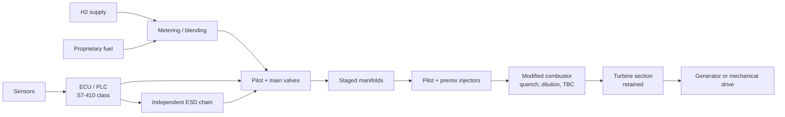

The cycle is the standard open Brayton cycle with gaseous fuel: intake, low-pressure and high-pressure compression, combustion at nearly constant pressure, high-pressure and low-pressure turbine expansion, exhaust. Details: [`docs/architecture.md`](docs/architecture.md).

## Control (ECU / PLC)

* Speed governor + exhaust-temperature limiter + gas-generator speed limiter, minimum-select, rate limiting, anti-windup.
* **Energy-based fuel mapping** through the inverse compressible-orifice relation, with composition compensation.
* **Pilot / main staging** with six unequal premix stages chosen to hold the primary-zone phi at or below 0.55.
* Start sequencer with **pre-start purge**, spark ignition on minimum pilot fuel, acceleration, idle, synchronisation and load ramp.
* Software trip layer (overspeed, exhaust temperature, flame loss, H2 leak, fuel pressure). The independent safety chain is separate.

Reference implementation in Python ([`src/gtretro/control.py`](src/gtretro/control.py)); illustrative PLC logic in SCL ([`plc/GT_Fuel_Control.scl`](plc/GT_Fuel_Control.scl), not compiled or tested on hardware). Details: [`docs/control_strategy.md`](docs/control_strategy.md), [`docs/plc_s7-410_notes.md`](docs/plc_s7-410_notes.md).

---

## Preliminary simulation results

Reference platform GT-A (assumed): single-shaft, 20 kg/s, pressure ratio 12, TIT 1300 K, about 5 MW electrical. All plots are generated by the code in this repository (`python simulation/run_all.py`); no screenshots are used.

### 1. Fuel chemistry and combustion indicators
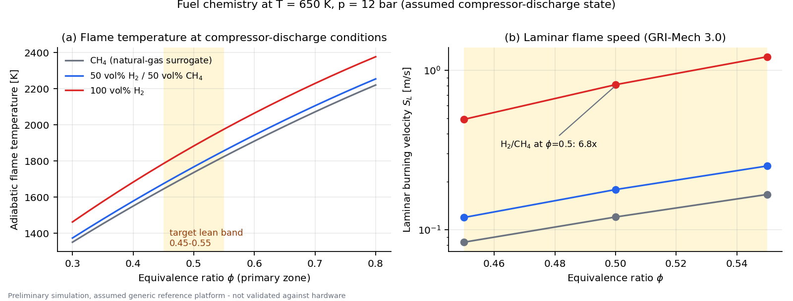

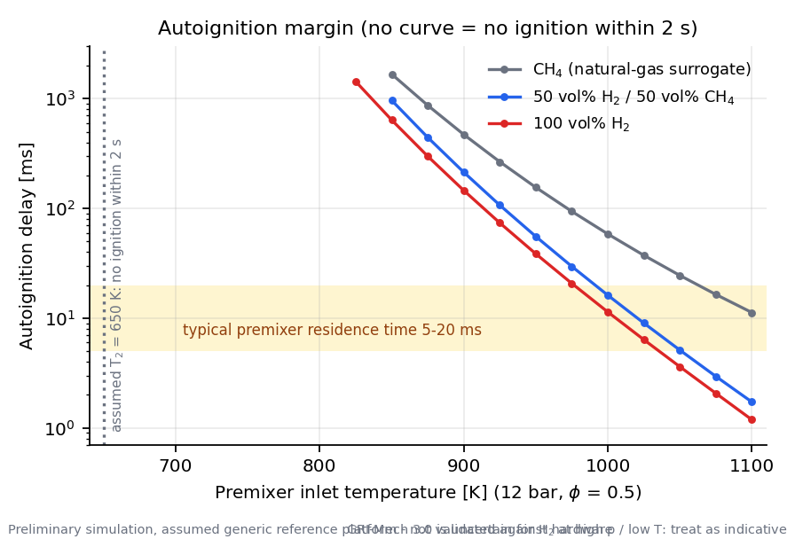 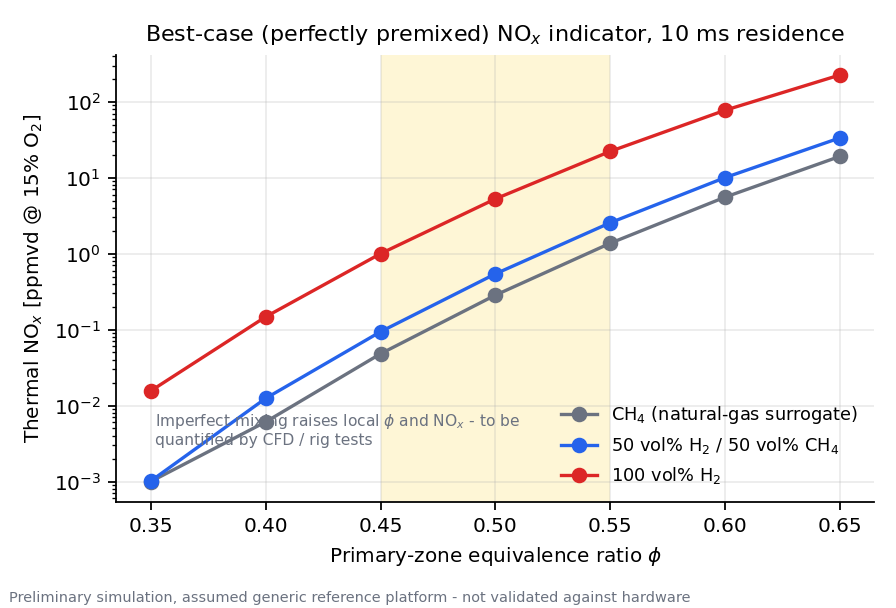

* Hydrogen's flame temperature and flame speed in the 0.45 - 0.55 band are well above methane's, which is why flashback margin and thermal protection drive the injector and combustor work.
* At the assumed 650 K compressor-discharge temperature, H2 does not autoignite within 2 s in this mechanism; the delay falls to about 11 ms at 1000 K, inside the typical premixer residence-time window. **Recuperated or high-pressure-ratio machines lose this margin.** (GRI-Mech 3.0 is uncertain for H2 at high pressure and low temperature.)
* The perfectly-premixed NOx indicator for H2 rises from 1.0 to 5.3 to 22 ppm (15 % O2) between phi = 0.45, 0.50 and 0.55. **The upper edge of the lean band matters**, and real mixing non-uniformity will make it worse (needs CFD and rig data).

### 2. Cycle, air split and ambient derating
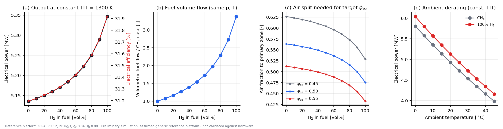

At constant TIT the output rises from 5.14 MW (CH4) to 5.35 MW (H2), +4 %, because the H2O-rich products carry more work per unit mass. The air fraction through the primary zone needed to hold phi = 0.5 falls from 0.56 to 0.48, so the **air split in the combustor has to be revisited** in a retrofit.

### 3. Fuel system sizing
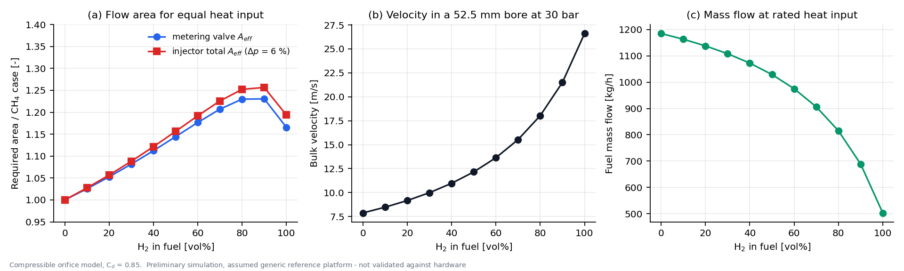

For equal heat input the valve and injector flow areas must grow by about 17 % and 19 % for pure H2, and by up to **23 % and 26 % near 90 vol% H2**, because the lower Wobbe index of H2/CH4 blends has a minimum near 80 - 90 % H2, not at 100 %. Line velocity in a 52.5 mm bore at 30 bar rises from 7.9 to 26.6 m/s.

### 4. Thermal protection
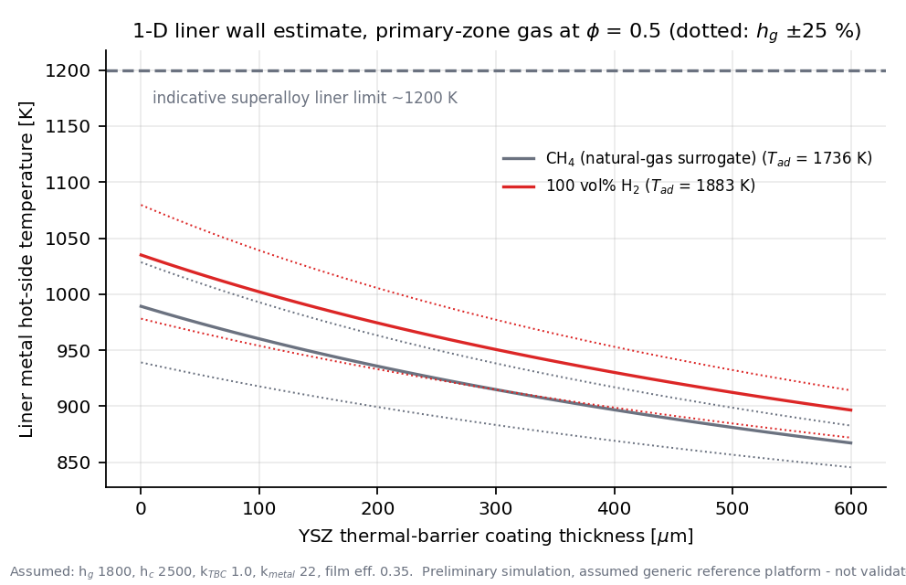

A 1-D liner estimate with film cooling shows the H2 primary zone running about 45 K hotter than methane at the same phi, and 600 micrometres of YSZ lowering the metal hot-side temperature by about 140 K. All coefficients are assumed.

### 5. Staged lean-premix schedule
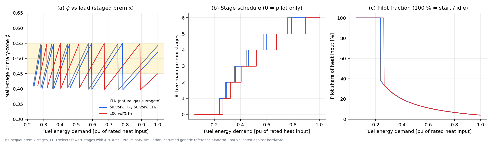

Six unequal premix stages keep phi between 0.40 and 0.55; 57 % (H2) to 66 % (CH4) of the 30 - 100 % load range falls inside the 0.45 - 0.55 target. The pilot carries everything at start and idle.

### 6. Start-up sequence (indicative)
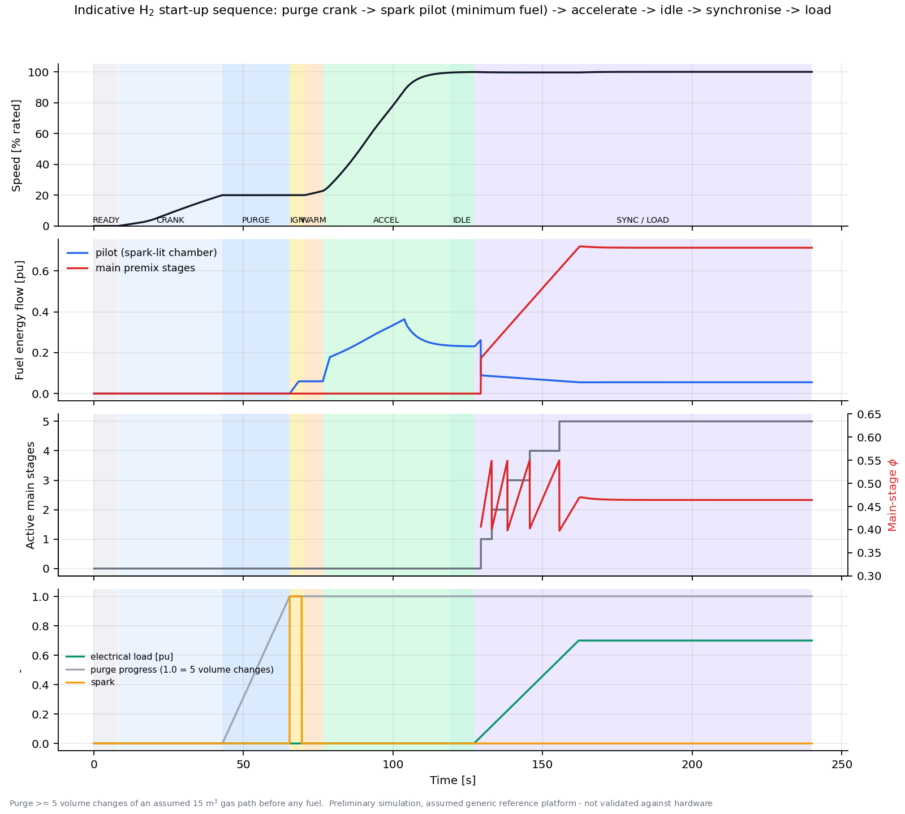

Purge of at least 5 volume changes (22.5 s with an assumed 15 m3 gas path), spark pilot at 0.06 pu, idle at about 119 s, 0.7 pu load at about 162 s. Timing is indicative only.

### 7. Load step and load rejection
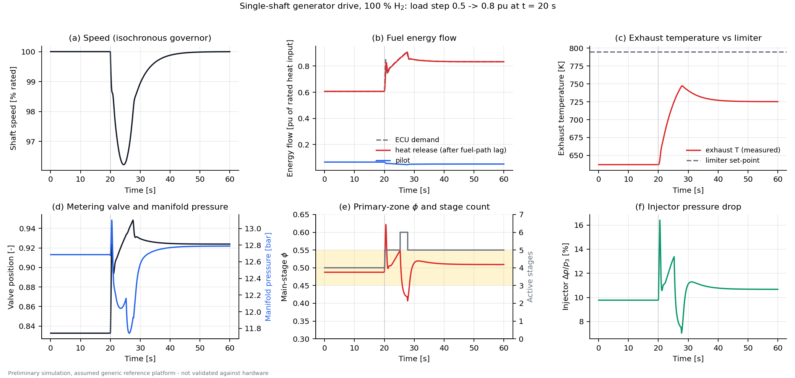

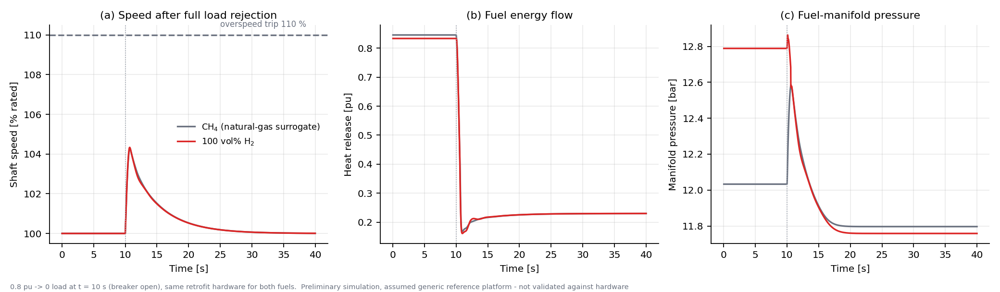

0.5 -> 0.8 pu load step on H2: minimum speed 96.2 %, back within 1 % after 10.3 s, peak exhaust temperature 760 K against a 795 K limit. Full load rejection from 0.8 pu: peak speed 104.3 % for both fuels, below the 110 % trip.

### 8. Fuel switching and composition compensation
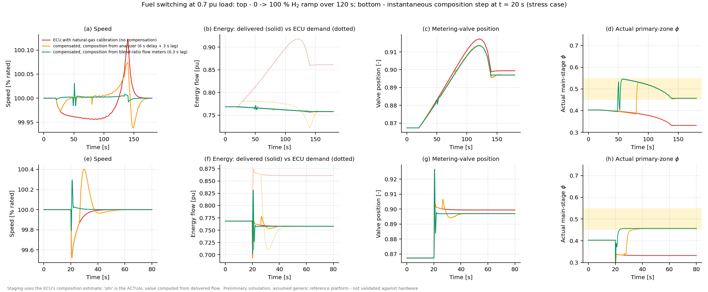

CH4 -> H2 at 0.7 pu load. With the **natural-gas calibration** the speed governor hides the change (speed deviation only 0.12 %), but the ECU's own energy estimate is **13.6 % wrong** and, because staging uses it, the **actual primary-zone phi drifts to 0.33**, below the lean target. With composition compensation the actual phi stays at 0.38 - 0.55. Using the **blend-ratio flow meters** as the composition source (0.3 s lag) instead of a gas analyzer (6 s delay) cuts the ramp speed deviation from 0.074 % to 0.031 %. In the instantaneous-step stress case the ratio-based compensation lowers the speed deviation (0.30 % vs 0.48 %) but causes a larger exhaust-temperature transient (+25 K vs +1 K), so the feed-forward needs rate shaping. This is open work.

### 9. Shaft and spool architectures
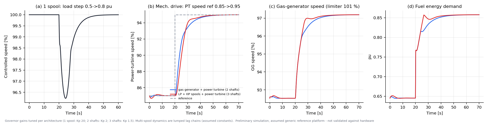

The same min-select structure, tuned per architecture, controls the single-shaft generator drive and the two- and three-shaft mechanical drives (90 % rise in 13.2 s and 10.0 s for a power-turbine speed step 0.85 -> 0.95, no overshoot). The multi-spool dynamics are lumped lag chains with assumed constants: this is an architecture-level check, not a physical spool model.

### 10. PLC scan time
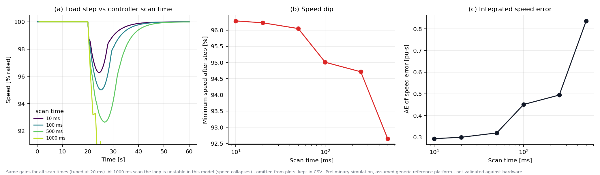

With fixed gains, a 20 - 50 ms scan costs almost nothing (speed dip 96.2 - 96.0 %); 100 ms gives 95.0 %, 500 ms gives 92.6 %, and at 1 s the loop is unstable in this model.

### 11. Flame loss and isolation (hydrogen safety)
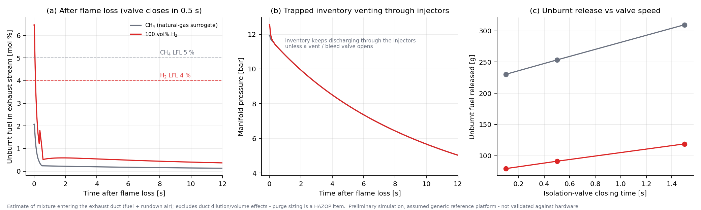

After a flame loss on 100 % H2 at 0.7 pu, the trip is requested within one 20 ms scan, but the unburnt-fuel mixture entering the exhaust stream peaks at about **6.5 mol %, above the 4 % lower flammable limit**, for 0.04 - 0.24 s depending on valve closing time (0.1 - 1.5 s). The methane case peaks at 2.1 % (limit 5 %). **Manifold inventory keeps discharging through the injectors** after the block valve shuts, so a vent / bleed valve to a safe location is needed in addition to block valves. Purge sizing is a HAZOP item.

Key numbers are collected in [`results/data/metrics_all.json`](results/data/metrics_all.json); every figure has its CSV in `results/data/`.

---

## Research areas

* Fuel delivery: storage interface, regulation, metering, blending, double block and bleed, vents, leak detection.
* Injectors and mixing: premixed, partially premixed, staged, multi-point, swirl-assisted; flashback and autoignition margins.
* Combustors: tubular, annular, can-annular; air split, quench / dilution geometry, liner cooling.
* Materials and coatings: hydrogen-embrittlement-resistant fuel-path materials (screening and testing with CSIR laboratories, partner to be confirmed) and thermal-barrier systems for the hot section.
* Electronic control: governor, limiters, fuel mapping, staging, sequencer, protection, PLC implementation.
* Safety: detect - decide - isolate - purge architecture, hazardous-area aspects.

## Development approach

Platform-specific modules rather than a universal kit; decision gates P0 - P9 from the concept note. This repository covers the simulation side of the control work and the interface definitions; see [`docs/validation_roadmap.md`](docs/validation_roadmap.md) for what is done and what is missing for each phase.

## Repository layout

```
README.md
requirements.txt
docs/                 architecture, control strategy, methodology, safety, PLC notes, IP & scope, roadmap
src/gtretro/          fuels, cycle, fuel_system, control, plant, startup (Python models)
plc/                  GT_Fuel_Control.scl (illustrative S7-400-class SCL)
simulation/           fuel_study.py, static_figs.py, dynamic_figs.py, run_all.py
results/figures/      14 generated figures
results/data/         CSV data and metrics (JSON)
tests/                11 sanity tests (pytest)
```

## Reproduce

```bash
pip install -r requirements.txt
python simulation/run_all.py          # all figures and data, about 10-15 min on one core
PYTHONPATH=src pytest -q              # sanity tests, about 10 s
```

## Limitations

* **Reduced-order, generic platform, no hardware data.** Parameters are assumed; absolute numbers (powers, temperatures, times) are indicative.
* Compressor and turbine maps, surge margin, IGV scheduling, thermoacoustics, flashback, blow-off, CO and real NOx are not modelled; chemistry results are for perfectly premixed gas and one kinetic mechanism.
* Multi-spool behaviour uses lumped lag chains; the start-up model is a simple power balance.
* The SCL file has not been compiled or run on a PLC. The safety functions described are design intent, not a validated safety case.
* The proprietary fuel is not represented; an H2-CH4 surrogate family stands in for variable fuel properties.

## License

All rights reserved (see [`LICENSE`](LICENSE)). Published for viewing and technical discussion.

## IP notice

No proprietary fuel composition, formulation, calibration data or component-level material allocations are published here. See [`docs/ip_and_scope.md`](docs/ip_and_scope.md).

## Future development

Hardware-in-the-loop on the S7-410 with this plant model; platform selection and a map-based plant; CFD and rig data for injector and combustor behaviour; rate-shaped composition feed-forward; HAZOP-driven trip and purge logic; small-turbine validation.

## Tools

Python, NumPy, SciPy, pandas, Matplotlib, Cantera (GRI-Mech 3.0), pytest; Siemens SIMATIC S7-410 class PLC (SCL).

## Author

Arun Roshan A S

Automotive R&D | Powertrain & Combustion | Hydrogen Combustion Retrofit | ECU & Embedded Systems

HERRSCHER (co-founded with Dinesh Pandi R), Coimbatore, Tamil Nadu, India
