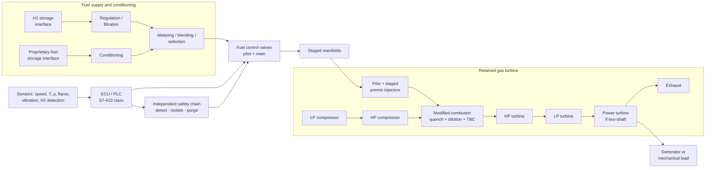

# System architecture

## 1. Concept

An existing open-cycle industrial gas turbine (Brayton cycle: intake -> compressor(s) -> combustor -> turbine(s) -> exhaust) is kept as it is. Only the subsystems whose requirements depend on the fuel are modified: fuel storage interface, fuel lines and valves, injectors, combustor thermal protection, sensors, **ECU / PLC control** and the safety chain.

## 2. Platform coverage (planned scope)

| Aspect | Variants the ECU architecture is intended to support | Where it is exercised in this repo |
|---|---|---|
| Combustor | tubular (can), annular, can-annular | Only through the **staging abstraction** (6 unequal premix stages + pilot); geometry-specific behaviour needs CFD and rig data |
| Shafts | single-shaft (generator drive), two-shaft (gas generator + free power turbine, mechanical drive) | `plant.py` arch = `single`, `two` |
| Spools | 1 to 3 spools (+ power turbine) | `plant.py` arch = `three` (lumped LP/HP lag chain, assumed constants) |
| Fuels | H2, H2/NG blends, HERRSCHER proprietary fuel | H2-CH4 **surrogate family**; the proprietary fuel is not modelled (see `ip_and_scope.md`) |
| Duty | power generation, mechanical drive | `single` (isochronous speed), `two`/`three` (power-turbine speed control) |

## 3. Module map (companion concept note, Table 10) and the ECU interface

| # | Module | ECU interface (signals) | Status in this repo |
|---|---|---|---|
| 1 | Fuel storage interface | supply pressure, isolation valve states | pressure assumed constant (30 bar) |
| 2 | H2 conditioning | regulator outlet pressure, filter dP | sizing only (`fuel_system.py`, fig05) |
| 3 | Proprietary-fuel conditioning | - | not modelled (IP) |
| 4 | Metering / blending | blend-ratio flows, composition estimate | composition estimate in `plant.py` (analyzer vs ratio) |
| 5 | Manifold | manifold pressure | gas-dynamic state model (volume 10 L, assumed) |
| 6 | Injector / nozzle | injector dP, stage valve states | 6 unequal premix stages + pilot (fig07) |
| 7 | Combustor modification | liner thermometry (planned) | 1-D wall estimate only (fig06) |
| 8 | Coating / material | - | candidate classes in companion note; not simulated beyond fig06 |
| 9 | Sensors | N, Ng, Tx, p, flame, vibration, H2 detection | idealised sensors with first-order lag |
| 10 | Control system | fuel demand, valve cmd, staging, limiters | `control.py` + `plc/GT_Fuel_Control.scl` |
| 11 | Safety system | trip request, valve fail-safe, purge | `Protection` class; flame-loss study (fig14) |
| 12 | Emissions monitoring | NOx / CO analyzer (planned) | indicator only (fig03) |

## 4. Operating modes

`READY -> CRANK -> PURGE -> IGNITION -> WARM-UP -> ACCEL -> IDLE (FSNL) -> SYNC / LOAD -> (RUN) -> NORMAL STOP / TRIP`

* **Ignition** is by spark in the **pilot chamber on minimum fuel** (0.06 pu in the simulation).
* The pilot / start circuit also carries the turbine through acceleration and the **idle run at rated speed** (about 0.23 pu).
* **Main premix stages** are brought in after synchronisation, in unequal stages, so that the primary-zone equivalence ratio stays in the lean band (target 0.45 - 0.55, envelope 0.40 - 0.55 in the current schedule).
